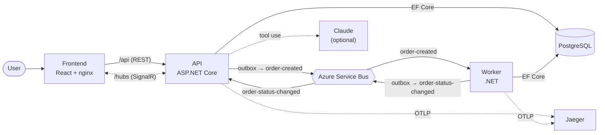
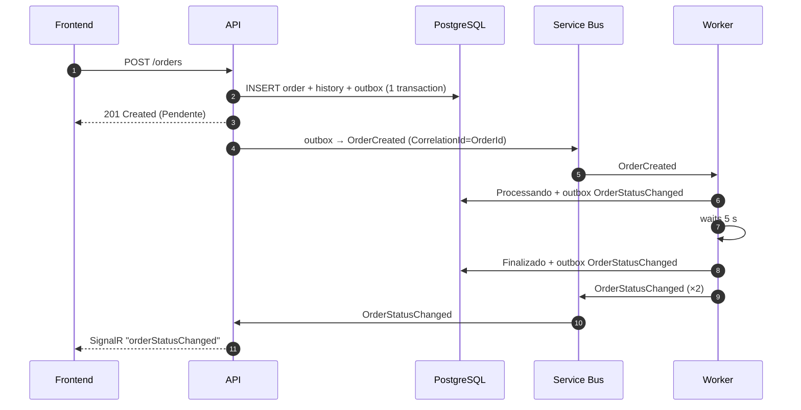
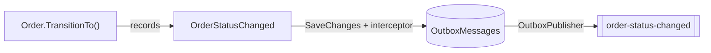

# Order Management (Gestão de Pedidos)

[](https://github.com/jotavfonseca/Gestao-de-Pedidos/actions/workflows/ci.yml)

[Português](README.md) · **English**

An order management system with asynchronous processing: the API stores the
order and publishes an event to **Azure Service Bus**; a **worker** consumes the
message, moves the order to *Processando* (processing) and, 5 seconds later, to
*Finalizado* (completed). The frontend follows every change in real time.

Solution to the **POC TMB** technical challenge ([brief, in Portuguese](docs/desafio-poc-tmb.md)).
Every decision is specified in [`specs/`](specs/README.md) (Spec Driven Development, in Portuguese).

> **About the language:** the domain uses the challenge's Portuguese vocabulary.
> `cliente` = customer, `produto` = product, `valor` = amount, `dataCriacao` = created at,
> `historico` = status history. Statuses: `Pendente` (pending) → `Processando`
> (processing) → `Finalizado` (completed). Code, infrastructure and technical terms are in English.

| | |
|---|---|
| **Backend** | .NET 8, ASP.NET Core, Entity Framework Core 8, PostgreSQL 16 |
| **Messaging** | Azure Service Bus (official emulator in Docker; a real namespace via connection string) |
| **Frontend** | React 19, Vite 7, Tailwind CSS 4, SignalR |
| **Infrastructure** | Docker Compose, pgAdmin, Jaeger (OpenTelemetry) |
| **AI (optional)** | Claude (official Anthropic C# SDK) |

**Features**

- Create, list and view orders (`POST /orders`, `GET /orders`, `GET /orders/{id}`).
- Mandatory status sequence **Pendente → Processando → Finalizado**, enforced by the domain model.
- **Outbox Pattern**: the order and its message are written in the same transaction.
- **Idempotent worker** (duplicate messages, redeliveries and concurrent deliveries).
- `CorrelationId = OrderId` and `EventType = OrderCreated` on every message.
- **Status history** with a timeline on the order details page.
- **Real-time updates with SignalR** and automatic fallback to polling.
- **Health checks** for the API, the database and the queue.
- **End-to-end tracing** (API → outbox → Service Bus → worker → API) in Jaeger.
- **Ask about your orders**: natural-language questions answered with real data.
- Domain, architecture, **golden** and **Testcontainers** integration tests, run in CI.

---

## Contents

1. [Getting started](#getting-started)
2. [URLs](#urls)
3. [Architecture](#architecture)
4. [Architecture and DDD](#architecture-and-ddd)
5. [API](#api)
6. [Environment variables](#environment-variables)
7. [Running without Docker](#running-without-docker)
8. [Tests](#tests)
9. [Design decisions](#design-decisions)
10. [Challenge requirements × implementation](#challenge-requirements--implementation)
11. [Troubleshooting](#troubleshooting)
12. [Project structure](#project-structure)

---

## Getting started

Requirement: **Docker** with Docker Compose (Docker Desktop on Windows/macOS). Give Docker about 4 GB of memory: the Service Bus emulator uses a SQL Server instance.

```bash
cp .env.example .env
docker compose up --build -d
```

The first run takes a few minutes to download the images. Watch `docker compose ps`: once `api`, `worker` and `frontend` are `healthy`, open **http://localhost:3000**.

To see the asynchronous flow, create an order and watch its status change on its own to *Processando* and, 5 s later, to *Finalizado*.

```bash
docker compose logs -f worker   # follow the processing
docker compose down             # stop (keeps the data)
docker compose down -v          # stop and delete the data
```

> **AI module:** set `ANTHROPIC_API_KEY` in `.env` and run `docker compose up -d api`. Without the key everything else works normally, and the "Pergunte" (Ask) page says the module is disabled.

## URLs

| Service | URL | Notes |
|---|---|---|
| Frontend | http://localhost:3000 | |
| API (Swagger) | http://localhost:5000/swagger | When `ASPNETCORE_ENVIRONMENT=Development` |
| Health | http://localhost:5000/health | API + PostgreSQL + Service Bus |
| pgAdmin | http://localhost:8080 | Login: `PGADMIN_DEFAULT_EMAIL` / `PGADMIN_DEFAULT_PASSWORD`; server already registered (database password: `POSTGRES_PASSWORD`) |
| Jaeger | http://localhost:16686 | Services `orders-api` and `orders-worker` |
| PostgreSQL | `localhost:5432` | |
| Service Bus (AMQP) | `localhost:5672` | Emulator |

## Architecture



Lifecycle of an order:



## Architecture and DDD

The domain is small (one aggregate, three statuses, one core rule), so it uses
**only the tactical DDD patterns that solve real problems**. Details in
[`specs/constitution.md` §4](specs/constitution.md).

| Used | Where |
|---|---|
| **Rich aggregate** `Order`: private setters, `Order.Create`, status changes only through `TransitionTo` | [`Domain/Orders/Order.cs`](shared/Orders.Core/Domain/Orders/Order.cs) |
| **Value object** `Money`: positive, 2 decimal places, value equality | [`Domain/Orders/Money.cs`](shared/Orders.Core/Domain/Orders/Money.cs) |
| **Domain events** `OrderCreated`, `OrderStatusChanged` | [`Domain/Orders/Events/`](shared/Orders.Core/Domain/Orders/Events) |
| **Thin application layer**: `CreateOrderHandler`, `OrderQueries`, `ProcessOrderHandler` | [`Application/Orders/`](shared/Orders.Core/Application/Orders) |
| **Domain exceptions** mapped to HTTP at the edge (400 / 409) | [`DomainExceptionHandler.cs`](api/Orders.Api/Infrastructure/DomainExceptionHandler.cs) |

Deliberately left out: generic repositories on top of EF (the `DbContext` is
already the unit of work), MediatR/formal CQRS (three use cases), one project per
layer (folders in `Orders.Core` are enough, and an
[architecture test](tests/Orders.Tests/Architecture/LayeringTests.cs) ensures the
domain depends on neither EF nor Service Bus), and bounded contexts.

**Aggregate → event → outbox → queue:** the aggregate records the event; a
`SaveChangesInterceptor` turns every event into an `OutboxMessage` in the same
transaction; the `OutboxPublisher` sends it to Service Bus. No use case contains
messaging code.



## API

| Method | Route | Description | Responses |
|---|---|---|---|
| `POST` | `/orders` | Create an order (`cliente`, `produto`, `valor`) | 201, 400 |
| `GET` | `/orders` | List orders (newest first) | 200 |
| `GET` | `/orders/{id}` | Details + status history | 200, 404 |
| `POST` | `/orders/ask` | Natural-language question (AI) | 200, 400, 502, 503 |
| `GET` | `/orders/ask/status` | Is the AI module enabled? | 200 |
| `GET` | `/health/live` | API process | 200 |
| `GET` | `/health/ready`, `/health` | API + PostgreSQL + Service Bus | 200, 503 |
| — | `/hubs/orders` | SignalR: `orderStatusChanged` event | |

```bash
curl -X POST http://localhost:5000/orders \
  -H "Content-Type: application/json" \
  -d '{"cliente":"Ana Souza","produto":"Teclado mecânico","valor":349.90}'
```

```json
{
  "id": "4f0c6c8e-2d3b-4a8e-9a51-1f2e3d4c5b6a",
  "cliente": "Ana Souza",
  "produto": "Teclado mecânico",
  "valor": 349.90,
  "status": "Pendente",
  "dataCriacao": "2026-11-19T13:00:00+00:00",
  "historico": [{ "status": "Pendente", "data": "2026-11-19T13:00:00+00:00" }]
}
```

- Field names follow the challenge brief in camelCase (`data_criacao` → `dataCriacao`).
- `status` and `dataCriacao` are set by the server; a `status` sent by the client is ignored.
- Errors follow [RFC 9457](https://www.rfc-editor.org/rfc/rfc9457) (`application/problem+json`), with per-field errors on `400`.
- More examples in [`Orders.Api.http`](api/Orders.Api/Orders.Api.http).

**Service Bus messages**

| Queue | `EventType` / `Subject` | `CorrelationId` | Body |
|---|---|---|---|
| `order-created` | `OrderCreated` | `OrderId` | `{ orderId, cliente, produto, valor, dataCriacao }` |
| `order-status-changed` | `OrderStatusChanged` | `OrderId` | `{ orderId, statusAnterior, status, changedAt }` |

`MessageId` is the outbox message id, and `traceparent` travels in the *application properties*.

## Environment variables

All of them are in [`.env.example`](.env.example). The main ones:

| Variable | Default | Purpose |
|---|---|---|
| `POSTGRES_DB` / `POSTGRES_USER` / `POSTGRES_PASSWORD` | `ordersdb` / `postgres` / `postgres` | Database |
| `PGADMIN_DEFAULT_EMAIL` / `PGADMIN_DEFAULT_PASSWORD` | `admin@example.com` / `admin` | pgAdmin |
| `ACCEPT_EULA` | `Y` | Accepts the emulator and SQL Server licenses |
| `MSSQL_SA_PASSWORD` | `Orders_Passw0rd!` | SQL Server used by the emulator |
| `SERVICEBUS_CONNECTION_STRING` | emulator | Replace with a real namespace connection string to use Azure |
| `WORKER_PROCESSING_DELAY_SECONDS` | `5` | Time between Processando and Finalizado |
| `ANTHROPIC_API_KEY` | empty | Enables the AI module |
| `API_PORT`, `FRONTEND_PORT`, `PGADMIN_PORT`, `POSTGRES_PORT`, `JAEGER_UI_PORT` | 5000, 3000, 8080, 5432, 16686 | Host ports |

**Real Azure:** create the `order-created` and `order-status-changed` queues in your
namespace and set `SERVICEBUS_CONNECTION_STRING`. No code changes are needed.

## Running without Docker

Requires the .NET 8 SDK, Node 20+, and reachable PostgreSQL and Service Bus instances. The simplest way is to start only the infrastructure with Compose:

```bash
docker compose up -d postgres sqlserver servicebus jaeger

# API (applies migrations on startup) — http://localhost:5000/swagger
dotnet run --project api/Orders.Api

# Worker (another terminal)
dotnet run --project worker/Orders.Worker

# Frontend (another terminal) — http://localhost:5173 (proxies to the API on :5000)
cd frontend && npm install && npm run dev
```

Development connection strings are in `appsettings.Development.json` (pointing to `localhost`).
To send traces locally, set `OTEL_EXPORTER_OTLP_ENDPOINT=http://localhost:4317` (Jaeger's port 4317 is not published by default; add it to the Compose file if you need it).

**Migrations** (tool pinned in `.config/dotnet-tools.json`):

```bash
dotnet tool restore
dotnet ef migrations add MigrationName --project shared/Orders.Core --output-dir Infrastructure/Persistence/Migrations
```

## Tests

```bash
dotnet test                     # all .NET tests
cd frontend && npm run lint && npm run build
```

| Suite | Covers | Needs Docker |
|---|---|---|
| `Domain/` | Status sequence, history, events, `Money` | No |
| `Architecture/` | Domain free of EF/Npgsql/Azure; application free of Service Bus | No |
| `Golden/` | API and message JSON compared with [`Golden/files`](tests/Orders.Tests/Golden/files) | No |
| `Infrastructure/` | Outbox in the same transaction, rollback, status stored as text, concurrency (`xmin`) | Yes |
| `Application/` | Idempotency: duplicates, redelivery while processing, concurrent deliveries | Yes |
| `Worker/` | Message validation and dead-lettering | Yes |
| `Api/` | Real HTTP endpoints (`WebApplicationFactory`) | Yes |
| `Ai/` | AI module tools with known data and time zone handling | Yes |

Integration tests start PostgreSQL with **Testcontainers**; without Docker they are **skipped** with a notice and the rest runs normally.

**Golden tests:** if you change a contract on purpose, regenerate with `UPDATE_GOLDEN=1 dotnet test` and review the diff of the `.json` files.

**CI:** on every push and pull request to `main`, [GitHub Actions](.github/workflows/ci.yml) builds and runs all .NET tests (with Testcontainers), lints and builds the frontend, and builds the Docker images.

## Design decisions

- **Outbox Pattern** — avoids the *dual write* problem (the database committed but the queue didn't, or vice versa). A background publisher reads the outbox with `FOR UPDATE SKIP LOCKED`; it runs in both the API **and** the worker, so either one drains pending messages. *At-least-once* delivery: failures increment `Attempts`/`LastError` and the message is resent once Service Bus is back.
- **Idempotent worker** — state machine + optimistic concurrency (PostgreSQL's `xmin` column). The current state decides what to do (Finalizado = ignore; Processando = resume), and two simultaneous deliveries cannot perform the same transition. There is no "processed messages" table because each transition can only happen once.
- **Dead-lettering** — unexpected `EventType`, invalid body or unknown order go straight to the DLQ; transient errors are redelivered up to `MaxDeliveryCount` (5).
- **Service Bus emulator** — the project runs without an Azure account. The queue health check uses *peek* (a data operation) because the emulator does not support the management APIs used by the off-the-shelf checks. The emulator image is pinned (`2.0.1`) for reproducible builds.
- **Real time** — the worker does not call the API: it publishes `OrderStatusChanged` (through the outbox) and the API forwards it over SignalR. SignalR negotiates WebSocket → SSE → long polling, and the frontend polls every 5 s while disconnected ("Tempo real / Polling" indicator at the top). With several API instances, the queue should become a *topic* with one *subscription* per instance (or Azure SignalR Service).
- **Same origin in the browser** — nginx (Docker) and Vite (dev) proxy `/api` and `/hubs`, so there is no CORS and no hard-coded API URL in the frontend.
- **AI module safety** — Claude never writes SQL: it can only call 5 fixed, read-only tools with validated parameters (status, period, limit). Relative dates are interpreted in the `America/Sao_Paulo` time zone. At most 6 tool rounds per question, server-side refusal fallback, and Anthropic errors mapped to 502/503 without leaking details.
- **Tracing** — the `traceparent` is stored in the outbox with the message, so the trace crosses the queue even when the send happens later, in another process.

## Challenge requirements × implementation

| Requirement | Implementation | Spec |
|---|---|---|
| `POST/GET /orders`, `GET /orders/{id}` | [`OrdersController`](api/Orders.Api/Controllers/OrdersController.cs) | [02](specs/02-api-rest.md) |
| Order attributes and statuses; mandatory sequence | [`Order`](shared/Orders.Core/Domain/Orders/Order.cs) | [01](specs/01-base-compartilhada.md) |
| Persist with EF + publish to Service Bus | Interceptor + [`OutboxPublisher`](shared/Orders.Core/Infrastructure/Outbox/OutboxPublisher.cs) | [03](specs/03-outbox-service-bus.md) |
| Worker: Processando → 5 s → Finalizado | [`ProcessOrderHandler`](shared/Orders.Core/Application/Orders/ProcessOrder.cs) | [04](specs/04-worker-idempotente.md) |
| Idempotent consumer | State + `xmin`; tests in [`ProcessOrderTests`](tests/Orders.Tests/Application/ProcessOrderTests.cs) | [04](specs/04-worker-idempotente.md) |
| `CorrelationId=OrderId`, `EventType=OrderCreated` | `OutboxPublisher.SendAsync` | [03](specs/03-outbox-service-bus.md) |
| Health checks for API, database and queue | [`HealthEndpoints`](api/Orders.Api/Health/HealthEndpoints.cs) | [05](specs/05-health-checks.md) |
| Responsive table, form, details, status feedback | [`frontend/src/pages`](frontend/src/pages) | [09](specs/09-frontend.md) |
| Compose with API, Worker, Frontend, PostgreSQL, PgAdmin; `.env`; health checks | [`docker-compose.yml`](docker-compose.yml) | [11](specs/11-infraestrutura.md) |
| Automatic migrations | [`DatabaseMigrator`](api/Orders.Api/Infrastructure/DatabaseMigrator.cs) | [02](specs/02-api-rest.md) |
| Bonus: Outbox (+3) | Interceptor + publisher | [03](specs/03-outbox-service-bus.md) |
| Bonus: Status history (+3) | `OrderStatusHistory` + timeline | [07](specs/07-historico-status.md) |
| Bonus: SignalR with fallback (+3) | [`OrdersHub`](api/Orders.Api/Realtime/OrdersHub.cs), [`RealtimeProvider`](frontend/src/realtime/RealtimeProvider.jsx) | [06](specs/06-signalr-fallback.md) |
| Bonus: Testcontainers (+1) | [`PostgresFixture`](tests/Orders.Tests/Infrastructure/PostgresFixture.cs) | [12](specs/12-testes.md) |
| Bonus: End-to-end tracing (+2) | OpenTelemetry + Jaeger | [08](specs/08-tracing.md) |
| Bonus: Golden tests (+2) | [`ContractGoldenTests`](tests/Orders.Tests/Golden/ContractGoldenTests.cs) | [12](specs/12-testes.md) |
| Bonus: AI/Analytics with an LLM (+5) | [`api/Orders.Api/Ai`](api/Orders.Api/Ai), "Pergunte" page | [10](specs/10-modulo-ia.md) |
| README, sample `.env`, diagrams | This file, [`.env.example`](.env.example) | [13](specs/13-documentacao.md) |

## Troubleshooting

| Symptom | Likely cause / fix |
|---|---|
| `api` takes a while to become `healthy` | On the first run SQL Server and the emulator take 1–2 min. Check `docker compose logs servicebus`. |
| `servicebus` restarts or `sqlserver` stops | Not enough memory for Docker (SQL Server needs ~2 GB) or a weak `MSSQL_SA_PASSWORD` (needs upper case, lower case, a digit and a symbol). |
| Postgres: *database files are incompatible with server* | A volume from an older PostgreSQL version. This project uses the `orders_pgdata` volume; to start from scratch: `docker compose down -v`. |
| Order stuck in *Pendente* | Service Bus unavailable: the outbox keeps the message and resends it. Check `curl localhost:5000/health/ready` and the `OutboxMessages` table (`Attempts`, `LastError`). |
| Indicator shows "Polling" | The SignalR connection dropped; the frontend keeps refreshing every 5 s and reconnects automatically. |
| "Módulo de IA desativado" (AI module disabled) | Set `ANTHROPIC_API_KEY` in `.env` and run `docker compose up -d api`. |
| Port already in use | Change `API_PORT`, `FRONTEND_PORT`, etc. in `.env`. |
| Integration tests skipped | Docker is not running. |

## Project structure

```
api/Orders.Api/          REST API, SignalR, health checks, AI module
worker/Orders.Worker/    Service Bus consumer
shared/Orders.Core/
  Domain/                Order aggregate, Money, domain events (no infrastructure)
  Application/           Use cases (create, query, process)
  Contracts/             Messages published to Service Bus
  Infrastructure/        EF Core, migrations, outbox, Service Bus
  Observability/         OpenTelemetry
tests/Orders.Tests/      Unit, architecture, golden and integration (Testcontainers) tests
frontend/                React + Tailwind (Vite), nginx
infra/                   Service Bus emulator and pgAdmin configuration
specs/                   Specifications (Spec Driven Development, in Portuguese)
docs/                    Challenge brief (in Portuguese)
.github/workflows/       CI (GitHub Actions)
```
