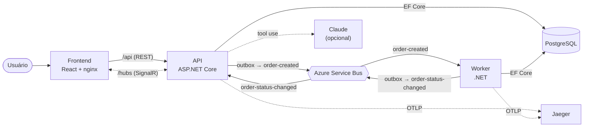
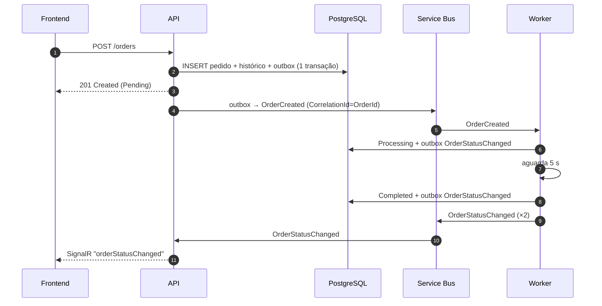
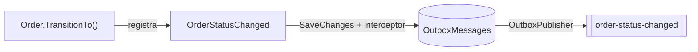

# Gestão de Pedidos (Order Management)

[](https://github.com/jotavfonseca/Gestao-de-Pedidos/actions/workflows/ci.yml)

[English](README.md) · **Português**

Sistema de gestão de pedidos com processamento assíncrono: a API grava o pedido
e publica um evento no **Azure Service Bus**; um **worker** consome a mensagem,
muda o status para *Processing* e, 5 segundos depois, para *Completed*. O
frontend acompanha tudo em tempo real.

Solução do desafio técnico **POC TMB** ([enunciado original](docs/desafio-poc-tmb.md)),
seguindo **Spec Driven Development**: todas as decisões estão em [`specs/`](specs/README.md).

> **Idioma:** o código, a API, a interface e as specs estão em inglês. O enunciado
> nomeia os campos em português (`cliente`, `produto`, `valor`, `data_criacao`) e os
> status como `Pendente`, `Processando`, `Finalizado`; eles foram renomeados de
> propósito para `customer`, `product`, `amount`, `createdAt` e `Pending`,
> `Processing`, `Completed` ([spec 15](specs/15-english-adaptation.md)). Uma
> migration atualiza bancos criados com os nomes originais.

| | |
|---|---|
| **Backend** | .NET 8, ASP.NET Core, Entity Framework Core 8, PostgreSQL 16 |
| **Mensageria** | Azure Service Bus (emulador oficial no Docker; namespace real por connection string) |
| **Frontend** | React 19, Vite 7, Tailwind CSS 4, SignalR |
| **Infra** | Docker Compose, pgAdmin, Jaeger (OpenTelemetry), GitHub Actions |
| **IA (opcional)** | Claude (SDK oficial da Anthropic para C#) |

**Funcionalidades**

- Criar, listar e detalhar pedidos (`POST /orders`, `GET /orders`, `GET /orders/{id}`).
- Sequência obrigatória **Pending → Processing → Completed**, garantida pelo domínio.
- **Outbox Pattern**: pedido e mensagem gravados na mesma transação.
- **Worker idempotente** (mensagens duplicadas, reentregas e entregas concorrentes).
- `CorrelationId = OrderId` e `EventType = OrderCreated` em toda mensagem.
- **Histórico de status** com linha do tempo na tela de detalhes.
- **Tempo real com SignalR** e fallback automático para polling.
- **Health checks** de API, banco e fila.
- **Tracing ponta a ponta** (API → outbox → Service Bus → worker → API) no Jaeger.
- **Pergunte sobre os pedidos** (tela "Ask"): perguntas em linguagem natural respondidas com dados reais.
- 53 testes — domínio, arquitetura, **golden** e integração com **Testcontainers** — rodando no CI.

---

## Sumário

1. [Como rodar](#como-rodar)
2. [Endereços](#endereços)
3. [Arquitetura](#arquitetura)
4. [Arquitetura e DDD](#arquitetura-e-ddd)
5. [API](#api)
6. [Variáveis de ambiente](#variáveis-de-ambiente)
7. [Rodar sem Docker](#rodar-sem-docker)
8. [Testes](#testes)
9. [Decisões de design](#decisões-de-design)
10. [Requisitos do desafio × implementação](#requisitos-do-desafio--implementação)
11. [Troubleshooting](#troubleshooting)
12. [Estrutura de pastas](#estrutura-de-pastas)

---

## Como rodar

Pré-requisito: **Docker** com Docker Compose (Docker Desktop no Windows/macOS). Reserve ~4 GB de memória para o Docker: o emulador do Service Bus usa um SQL Server.

```bash
cp .env.example .env
docker compose up --build -d
```

Na primeira vez o download das imagens leva alguns minutos. Acompanhe com `docker compose ps`: quando `api`, `worker` e `frontend` estiverem `healthy`, abra **http://localhost:3000**.

Para ver o fluxo assíncrono: crie um pedido e observe o status mudar sozinho para *Processing* e, 5 s depois, *Completed*.

```bash
docker compose logs -f worker   # acompanhar o processamento
docker compose down             # parar (mantém os dados)
docker compose down -v          # parar e apagar os dados
```

> **Módulo de IA:** preencha `ANTHROPIC_API_KEY` no `.env` e rode `docker compose up -d api`. Sem a chave, o resto do sistema funciona normalmente e a tela "Ask" mostra que o módulo está desativado.

## Endereços

| Serviço | URL | Observação |
|---|---|---|
| Frontend | http://localhost:3000 | |
| API (Swagger) | http://localhost:5000/swagger | Em `ASPNETCORE_ENVIRONMENT=Development` |
| Health | http://localhost:5000/health | API + PostgreSQL + Service Bus |
| pgAdmin | http://localhost:8080 | Login: `PGADMIN_DEFAULT_EMAIL` / `PGADMIN_DEFAULT_PASSWORD`; servidor já cadastrado (senha do banco: `POSTGRES_PASSWORD`) |
| Jaeger | http://localhost:16686 | Serviços `orders-api` e `orders-worker` |
| PostgreSQL | `localhost:5432` | |
| Service Bus (AMQP) | `localhost:5672` | Emulador |

## Arquitetura



Fluxo de um pedido:



## Arquitetura e DDD

O domínio é pequeno (um agregado, três status, uma regra central), então
usamos **só os padrões táticos de DDD que resolvem problemas reais** — detalhes
em [`specs/constitution.md` §4](specs/constitution.md).

| Usamos | Onde |
|---|---|
| **Agregado rico** `Order`: setters privados, `Order.Create`, mudança de status só por `TransitionTo` | [`Domain/Orders/Order.cs`](shared/Orders.Core/Domain/Orders/Order.cs) |
| **Value object** `Money`: valor positivo, 2 casas, igualdade por valor | [`Domain/Orders/Money.cs`](shared/Orders.Core/Domain/Orders/Money.cs) |
| **Eventos de domínio** `OrderCreated`, `OrderStatusChanged` | [`Domain/Orders/Events/`](shared/Orders.Core/Domain/Orders/Events) |
| **Camada de aplicação fina**: `CreateOrderHandler`, `OrderQueries`, `ProcessOrderHandler` | [`Application/Orders/`](shared/Orders.Core/Application/Orders) |
| **Exceções de domínio** traduzidas para HTTP na borda (400 / 409) | [`DomainExceptionHandler.cs`](api/Orders.Api/Infrastructure/DomainExceptionHandler.cs) |

Deixados de fora de propósito: repositórios genéricos sobre o EF (o `DbContext`
já é unidade de trabalho), MediatR/CQRS formal (três casos de uso), um projeto
por camada (as pastas de `Orders.Core` bastam, e um
[teste de arquitetura](tests/Orders.Tests/Architecture/LayeringTests.cs) garante
que o domínio não depende de EF nem do Service Bus) e bounded contexts.

**Agregado → evento → outbox → fila:** o agregado registra o evento; um
`SaveChangesInterceptor` converte cada evento em `OutboxMessage` na mesma
transação; o `OutboxPublisher` envia para o Service Bus. Nenhum caso de uso
escreve código de mensageria.



## API

| Método | Rota | Descrição | Respostas |
|---|---|---|---|
| `POST` | `/orders` | Cria pedido (`customer`, `product`, `amount`) | 201, 400 |
| `GET` | `/orders` | Lista pedidos (mais recentes primeiro) | 200 |
| `GET` | `/orders/{id}` | Detalhes + histórico | 200, 404 |
| `POST` | `/orders/ask` | Pergunta em linguagem natural (IA) | 200, 400, 502, 503 |
| `GET` | `/orders/ask/status` | Módulo de IA ativo? | 200 |
| `GET` | `/health/live` | Processo da API | 200 |
| `GET` | `/health/ready`, `/health` | API + PostgreSQL + Service Bus | 200, 503 |
| — | `/hubs/orders` | SignalR: evento `orderStatusChanged` | |

```bash
curl -X POST http://localhost:5000/orders \
  -H "Content-Type: application/json" \
  -d '{"customer":"Jane Doe","product":"Mechanical keyboard","amount":349.90}'
```

```json
{
  "id": "4f0c6c8e-2d3b-4a8e-9a51-1f2e3d4c5b6a",
  "customer": "Jane Doe",
  "product": "Mechanical keyboard",
  "amount": 349.90,
  "status": "Pending",
  "createdAt": "2026-11-19T13:00:00+00:00",
  "statusHistory": [{ "status": "Pending", "changedAt": "2026-11-19T13:00:00+00:00" }]
}
```

- `status` e `createdAt` são definidos pelo servidor; se o cliente enviar `status`, ele é ignorado.
- Erros seguem [RFC 9457](https://www.rfc-editor.org/rfc/rfc9457) (`application/problem+json`), com erros por campo no `400`. As mensagens estão em inglês.
- Mais exemplos em [`Orders.Api.http`](api/Orders.Api/Orders.Api.http).

**Mensagens no Service Bus**

| Fila | `EventType` / `Subject` | `CorrelationId` | Corpo |
|---|---|---|---|
| `order-created` | `OrderCreated` | `OrderId` | `{ orderId, customer, product, amount, createdAt }` |
| `order-status-changed` | `OrderStatusChanged` | `OrderId` | `{ orderId, previousStatus, status, changedAt }` |

`MessageId` é o id da mensagem no outbox, e `traceparent` vai nas *application properties*.

## Variáveis de ambiente

Todas em [`.env.example`](.env.example). As principais:

| Variável | Padrão | Uso |
|---|---|---|
| `POSTGRES_DB` / `POSTGRES_USER` / `POSTGRES_PASSWORD` | `ordersdb` / `postgres` / `postgres` | Banco |
| `PGADMIN_DEFAULT_EMAIL` / `PGADMIN_DEFAULT_PASSWORD` | `admin@example.com` / `admin` | pgAdmin |
| `ACCEPT_EULA` | `Y` | Aceite das licenças do emulador e do SQL Server |
| `MSSQL_SA_PASSWORD` | `Orders_Passw0rd!` | SQL Server do emulador |
| `SERVICEBUS_CONNECTION_STRING` | emulador | Troque pela connection string de um namespace real para usar o Azure |
| `WORKER_PROCESSING_DELAY_SECONDS` | `5` | Tempo entre Processing e Completed |
| `ANTHROPIC_API_KEY` | vazio | Ativa o módulo de IA |
| `API_PORT`, `FRONTEND_PORT`, `PGADMIN_PORT`, `POSTGRES_PORT`, `JAEGER_UI_PORT` | 5000, 3000, 8080, 5432, 16686 | Portas no host |

**Azure real:** crie as filas `order-created` e `order-status-changed` no namespace e defina
`SERVICEBUS_CONNECTION_STRING`. Nenhum código muda.

## Rodar sem Docker

Requer .NET SDK 8, Node 20+ e um PostgreSQL e um Service Bus acessíveis. O jeito mais simples é subir só a infraestrutura pelo Compose:

```bash
docker compose up -d postgres sqlserver servicebus jaeger

# API (aplica as migrations ao iniciar) — http://localhost:5000/swagger
dotnet run --project api/Orders.Api

# Worker (outro terminal)
dotnet run --project worker/Orders.Worker

# Frontend (outro terminal) — http://localhost:5173 (proxy para a API em :5000)
cd frontend && npm install && npm run dev
```

As connection strings de desenvolvimento estão em `appsettings.Development.json` (apontam para `localhost`).
Para enviar traces localmente, defina `OTEL_EXPORTER_OTLP_ENDPOINT=http://localhost:4317` (a porta 4317 do Jaeger não é publicada por padrão; adicione-a ao Compose se precisar).

**Migrations** (ferramenta fixada em `.config/dotnet-tools.json`):

```bash
dotnet tool restore
dotnet ef migrations add NomeDaMigration --project shared/Orders.Core --output-dir Infrastructure/Persistence/Migrations
```

## Testes

```bash
dotnet test                     # todos os testes (.NET)
cd frontend && npm run lint && npm run build
```

| Suíte | O que cobre | Precisa de Docker |
|---|---|---|
| `Domain/` | Sequência de status, histórico, eventos, `Money` | Não |
| `Architecture/` | Domínio sem EF/Npgsql/Azure; aplicação sem Service Bus | Não |
| `Golden/` | JSON da API e das mensagens comparados com [`Golden/files`](tests/Orders.Tests/Golden/files) | Não |
| `Infrastructure/` | Outbox na mesma transação, rollback, status como texto, concorrência (`xmin`), migration sobre dados existentes | Sim |
| `Application/` | Idempotência: duplicata, reentrega em Processing, entregas concorrentes | Sim |
| `Worker/` | Validação de mensagem e dead-letter | Sim |
| `Api/` | Endpoints HTTP reais (`WebApplicationFactory`) | Sim |
| `Ai/` | Ferramentas do módulo IA com dados conhecidos e fuso horário | Sim |

Os testes de integração sobem um PostgreSQL com **Testcontainers**; sem Docker eles são **pulados** com aviso, e o resto roda normalmente.

**Golden tests:** se você mudar um contrato de propósito, regenere com `UPDATE_GOLDEN=1 dotnet test` e revise o diff dos arquivos `.json`.

**CI:** a cada push e pull request para `main`, o [GitHub Actions](.github/workflows/ci.yml) roda o build e todos os testes .NET (com Testcontainers), o lint e o build do frontend e o build das imagens Docker.

## Decisões de design

- **Outbox Pattern** — evita o *dual write* (banco gravou e fila não, ou vice-versa). Um publicador em background lê o outbox com `FOR UPDATE SKIP LOCKED`; ele roda na API **e** no worker, então qualquer um escoa as mensagens pendentes. Entrega *at-least-once*: falhas incrementam `Attempts`/`LastError` e a mensagem é reenviada quando o Service Bus volta.
- **Idempotência no worker** — máquina de estados + concorrência otimista (coluna `xmin` do PostgreSQL). O estado atual decide o que fazer (Completed = ignora; Processing = retoma) e duas entregas simultâneas não conseguem fazer a mesma transição. Não há tabela de "mensagens processadas" porque cada transição só pode ocorrer uma vez.
- **Dead-letter** — `EventType` inesperado, corpo inválido ou pedido inexistente vão direto para a DLQ; erros transitórios são reentregues até `MaxDeliveryCount` (5).
- **Emulador do Service Bus** — o projeto roda sem conta Azure. O health check da fila usa *peek* (operação de dados), porque o emulador não suporta as APIs de administração usadas pelos checks prontos. A imagem do emulador é fixada (`2.0.1`) para builds reproduzíveis.
- **Tempo real** — o worker não chama a API: publica `OrderStatusChanged` (pelo outbox) e a API repassa via SignalR. O SignalR negocia WebSocket → SSE → long polling, e o frontend faz polling a cada 5 s enquanto estiver desconectado (indicador "Live / Polling" no topo). Com várias instâncias da API, a fila deveria virar um *topic* com uma *subscription* por instância (ou Azure SignalR Service).
- **Mesma origem no navegador** — o nginx (Docker) e o Vite (dev) fazem proxy de `/api` e `/hubs`, então não há CORS nem URL de API fixa no frontend.
- **Segurança do módulo de IA** — o Claude não escreve SQL: só chama 5 ferramentas fixas, somente leitura, com parâmetros validados (status, período, limite). Datas relativas são interpretadas num fuso configurável (`Ai__TimeZone`, padrão `America/Sao_Paulo`). Limite de 6 rodadas de ferramentas por pergunta, fallback de recusa no servidor e erros da Anthropic traduzidos para 502/503 sem vazar detalhes.
- **Tracing** — o `traceparent` é salvo no outbox junto com a mensagem, então o trace atravessa a fila mesmo quando o envio acontece depois, em outro processo.

## Requisitos do desafio × implementação

| Requisito | Implementação | Spec |
|---|---|---|
| `POST/GET /orders`, `GET /orders/{id}` | [`OrdersController`](api/Orders.Api/Controllers/OrdersController.cs) | [02](specs/02-rest-api.md) |
| Atributos e status do pedido; sequência obrigatória | [`Order`](shared/Orders.Core/Domain/Orders/Order.cs) | [01](specs/01-shared-core-and-domain.md) |
| Persistir com EF + publicar no Service Bus | Interceptor + [`OutboxPublisher`](shared/Orders.Core/Infrastructure/Outbox/OutboxPublisher.cs) | [03](specs/03-outbox-service-bus.md) |
| Worker: Processing → 5 s → Completed | [`ProcessOrderHandler`](shared/Orders.Core/Application/Orders/ProcessOrder.cs) | [04](specs/04-idempotent-worker.md) |
| Consumidor idempotente | Estado + `xmin`; testes em [`ProcessOrderTests`](tests/Orders.Tests/Application/ProcessOrderTests.cs) | [04](specs/04-idempotent-worker.md) |
| `CorrelationId=OrderId`, `EventType=OrderCreated` | `OutboxPublisher.SendAsync` | [03](specs/03-outbox-service-bus.md) |
| Health checks de API, banco e fila | [`HealthEndpoints`](api/Orders.Api/Health/HealthEndpoints.cs) | [05](specs/05-health-checks.md) |
| Tabela responsiva, formulário, detalhes, feedback de status | [`frontend/src/pages`](frontend/src/pages) | [09](specs/09-frontend.md) |
| Compose com API, Worker, Frontend, PostgreSQL, PgAdmin; `.env`; healthchecks | [`docker-compose.yml`](docker-compose.yml) | [11](specs/11-infrastructure.md) |
| Migrations automáticas | [`DatabaseMigrator`](api/Orders.Api/Infrastructure/DatabaseMigrator.cs) | [02](specs/02-rest-api.md) |
| Bônus: Outbox (+3) | Interceptor + publicador | [03](specs/03-outbox-service-bus.md) |
| Bônus: Histórico de status (+3) | `OrderStatusHistory` + linha do tempo | [07](specs/07-status-history.md) |
| Bônus: SignalR com fallback (+3) | [`OrdersHub`](api/Orders.Api/Realtime/OrdersHub.cs), [`RealtimeProvider`](frontend/src/realtime/RealtimeProvider.jsx) | [06](specs/06-signalr-fallback.md) |
| Bônus: Testcontainers (+1) | [`PostgresFixture`](tests/Orders.Tests/Infrastructure/PostgresFixture.cs) | [12](specs/12-tests.md) |
| Bônus: Tracing ponta a ponta (+2) | OpenTelemetry + Jaeger | [08](specs/08-tracing.md) |
| Bônus: Golden tests (+2) | [`ContractGoldenTests`](tests/Orders.Tests/Golden/ContractGoldenTests.cs) | [12](specs/12-tests.md) |
| Bônus: IA/Analytics com LLM (+5) | [`api/Orders.Api/Ai`](api/Orders.Api/Ai), tela "Ask" | [10](specs/10-ai-module.md) |
| README, `.env` de exemplo, diagramas | Este arquivo, [`.env.example`](.env.example) | [13](specs/13-documentation.md) |

## Troubleshooting

| Sintoma | Causa provável / solução |
|---|---|
| `api` demora a ficar `healthy` | Na primeira subida o SQL Server e o emulador levam 1–2 min. Veja `docker compose logs servicebus`. |
| `servicebus` reinicia ou `sqlserver` cai | Pouca memória para o Docker (o SQL Server pede ~2 GB) ou `MSSQL_SA_PASSWORD` fraca (precisa de maiúscula, minúscula, número e símbolo). |
| Postgres: *database files are incompatible with server* | Volume de uma versão anterior do PostgreSQL. Este projeto usa o volume `orders_pgdata`; para recomeçar do zero: `docker compose down -v`. |
| Pedido fica em *Pending* | Service Bus indisponível: o outbox guarda a mensagem e reenvia. Confira `curl localhost:5000/health/ready` e a tabela `OutboxMessages` (`Attempts`, `LastError`). |
| Indicador mostra "Polling" | A conexão SignalR caiu; o frontend continua atualizando a cada 5 s e reconecta sozinho. |
| "AI module disabled" | Defina `ANTHROPIC_API_KEY` no `.env` e rode `docker compose up -d api`. |
| Porta em uso | Ajuste `API_PORT`, `FRONTEND_PORT` etc. no `.env`. |
| Testes de integração pulados | Docker não está rodando. |

## Estrutura de pastas

```
api/Orders.Api/          API REST, SignalR, health checks, módulo de IA
worker/Orders.Worker/    Consumidor do Service Bus
shared/Orders.Core/
  Domain/                Agregado Order, Money, eventos de domínio (sem infraestrutura)
  Application/           Casos de uso (criar, consultar, processar)
  Contracts/             Mensagens publicadas no Service Bus
  Infrastructure/        EF Core, migrations, outbox, Service Bus
  Observability/         OpenTelemetry
tests/Orders.Tests/      Unitários, arquitetura, golden, integração (Testcontainers)
frontend/                React + Tailwind (Vite), nginx
infra/                   Configuração do emulador do Service Bus e do pgAdmin
specs/                   Especificações (Spec Driven Development, em inglês)
docs/                    Enunciado do desafio (original em português + resumo em inglês)
.github/workflows/       CI (GitHub Actions)
```
